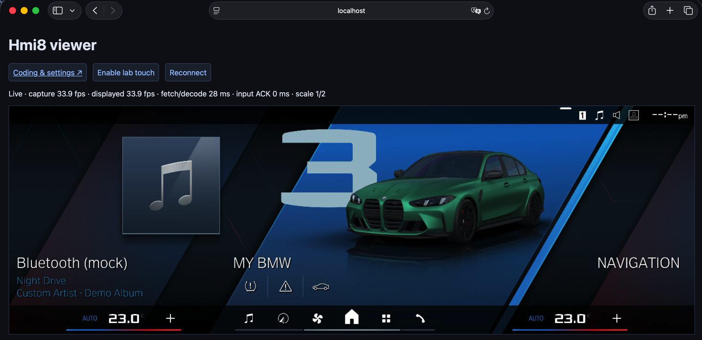
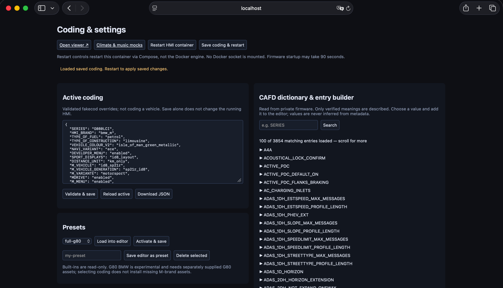

# BMW IDrive 8.5 Emulator

## WARNING: It will only work on a Mac with M Chips, macOS 26+.


### A standalone Idrive8.5 Emulator which runs on ARM linux based VM locally on a Mac. No connection to anything else.
### Featuring a G80 M3 and a i4 G26 emulator preset.


### Main Viewer (http://127.0.0.1:5011):


### Setting/Coding Page (http://127.0.0.1:5012):


#### Output will show on a website, use the mouse to control the Emulator.

## Architecture

Mac → Lima/Krunkit Fedora VM → privileged ARM64 Docker container → firmware chroot.

Docker alone cannot replace the VM's host-GPU bridge.  The bundle contains a tooling-only
Docker image, not a VM image disguised as a Docker image.

There are no Mac directory mounts in the VM configuration. Setup copies the original MGU22 firmware files
into the new VM. Docker bind mounts guest directories:

- `/srv/bmw-idrive85/state` → `/srv/hmi8-lab`: private extracted runtime and state.
- `/srv/bmw-idrive85/driver` → `/opt/venus`: guest driver libraries, read-only.
- `/srv/bmw-idrive85/source/{runtime,container,web,config}` → tool/UI directories,
  read-only.

Neither original research VM is modified by setup. 
The default new VM in `limactl`(lima) is `bmw-idrive85`, 6 vCPUs, 4 GiB RAM, 20 GiB sparse disk. 


## Requirements and compatibility

### Download the necessary original MGU22 Firmware folders from this [shared drive](https://mega.nz/folder/fU0nUYRa#B0T0UnUgVRaTKrpcO-1A2A) 

I cannot upload the files to github because of their big file size.

Files needed from the shared drive:

```aiignore
SWFL:
swfl_00009FC6(ivi_fs.zip) --> contains the actual HMI8 binary and it's supporting libraries and services
swfl_00009FF7(ROOT_rootfs.zip) ---> Base linux filesystem, of a MGU22 Headunit. 
swfl_00009FF9(ext_fs.zip) --> additional libraries for ROOT and IVI

SWFK:
swfk_0000A6B0 --> Shared BMW interface resources
swfk_0000A6B1 --> BMW interface resources(non M models)
swfk_0000A6B2 --> M chassis BMW interface resources
swfk_0000AED4 --> G26 i4 graphics
swfk_0000AED4 --> G80 M3 graphics

```

- Apple Silicon Mac, macOS **26.0 or newer**
  It uses the Metal 4 API, which has been introduced in macOS 26.
- Tested on a M1 Pro, macOS 26.7.1, Lima 2.1.4, Krunkit 1.3.2. 
- At least 4 GiB available guest RAM recommended, 16 GiB total host RAM recommended.
- At least 25 GiB of free disk space before installation (enforced by the installer). Keep additional space for your BMW source files or extracted backup; navigation maps are not included in this requirement.
- Homebrew in `/opt/homebrew`, Python 3.11+, SSH and Xcode command-line tools.
- Homebrew Lima, Krunkit, Vulkan loader, libepoxy and SPIR-V Tools. The supplied
  host dylibs reference `/opt/homebrew/opt/...`; `doctor.sh` checks these paths.
- Network access on first setup for Fedora and Linux Docker packages.

Install missing prerequisites yourself, after reviewing their upstream sources:

```sh
brew install lima python vulkan-loader libepoxy spirv-tools
brew install libkrun/krun/krunkit
```

## First run

The emulator needs BMW firmware packages that this project needs, located in the [Shared drive](https://mega.nz/folder/fU0nUYRa#B0T0UnUgVRaTKrpcO-1A2A).

**A. Clone the repo**
```sh
git clone https://github.com/rishik250809/bmw-idrive8.5-emulator
cd bmw-idrive8.5-emulator
```

**B. Run the install script.** 

**Before running**, Put the extraced BMW packages from the shared drive into `bmw-files/`
(the list is in [`bmw-files/README.md`](bmw-files/README.md)), then:

```sh
bash install.sh                       # or: bash install.sh /path/to/copyofshareddrive
```

It installs the Homebrew tools, downloads and verifies the open-source graphics
pieces, creates the VM, verifies and imports your BMW files, starts the HMI,
waits until it is on screen and opens http://localhost:5011. Takes about roughly 5 minutes. Running it again skips
finished steps. Afterwards just use `bash start.sh` (G26) or `bash start.sh g80-m` (G80).

**C. From a prepared private bundle** (`private/runtime.tar.gz`, made from your
own files; never share it):

```sh
bash doctor.sh
bash setup.sh
bash start.sh g80-m
```

First ensure no other viewer uses ports 5011/5012, or choose another port pair.

Open `http://localhost:5011` for viewer/touch and `http://localhost:5012` for
coding/settings. Music/climate controls are at `http://localhost:5012/mocks`.
Allow around one minute for initialization.

Switch to the ordinary BMW electric setup with `bash start.sh g26`.
No argument restarts the current profile. One renderer runs at a time.
`bash stop.sh` stops the container; `bash stop.sh --vm` also shuts down the VM.
The settings Restart button restarts only the container.

If 5011/5012 are occupied, use `BMW_VIEWER_PORT=5021 bash start.sh g80-m`.
This forwards guest ports 5011/5012 to Mac ports 5021/5022. Hyperlinks follow
the adjacent port pair. Set `BMW_VM` consistently on all commands if choosing
a different VM name.

Setup refuses to overwrite an existing runtime. Never delete the guest state
directory without backing up coding and mock values. To update UI/source
without reimporting firmware, use `bash scripts/sync_source.sh`, then restart
the selected profile.

## Presets given in the Drive folder

- `barestock`: only developer menu, sport displays and km units coded; everything else
  uses the firmware defaults (G26 BEV, BMW).
- `full-g26`: G26 BEV (i4), BMW brand, electric, navigation, home tiles. (**proper coding**)
- `full-g80`: G80 LCI (M3), BMW M brand, petrol, Isle of Man Green and the
  tested M feature flags. (**proper coding**)
- More in the future!

If the brand/model is specified as `HMI_BRAND`: `bmw_m`, it mounts the BMW M brand package
(SWFK 0000A6B2), otherwise `bmw` uses the base BMW package (A6B1). The car graphics follow
`SERIES` (G026BEV, G080LCI, G082LCI). 
Each series/brand combination keeps its own
saved HMI state, created on first use.
Use `start.sh` to switch complete profiles and preserve outgoing coding.

Mock features are display-state simulations, not actual Bluetooth/audio/HVAC.
Navigation, AR camera, ConnectedDrive and other full vehicle services are not provided (for now).

If you want one more model to be added, hit me up a request in **Issue**,
or ask claude to do that.

**If you want to use AI to add another car model(if you have psdzdata full):**

You have [swe_names_all.tsv](swe_names_all.tsv) located in this project to show you, which files you need for which model if you have the psdzdata full. 
Please use the LCI Chassis files, as the non-lci Chassis files are presumably meant for IDrive7/Idrive8, which will **NOT** work.

Give these files to claude or your other preferred AI and let him disassemble the bin file, implement the appropiate codings and data files to let the VM boot to the correct preset.


```sh
limactl shell --workdir=/srv/bmw-idrive85/source bmw-idrive85 -- sudo docker build -t bmw-idrive85-tools:local .
BMW_TOOLS_IMAGE=bmw-idrive85-tools:local bash start.sh g80-m
```

### Credits go to BMW AG, BMW Car IT GmbH, DENSO Corporation and other Companies. This is a research experiment, it is not meant for redistribution, at all.
